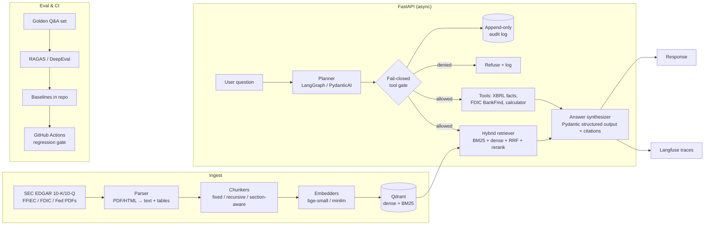
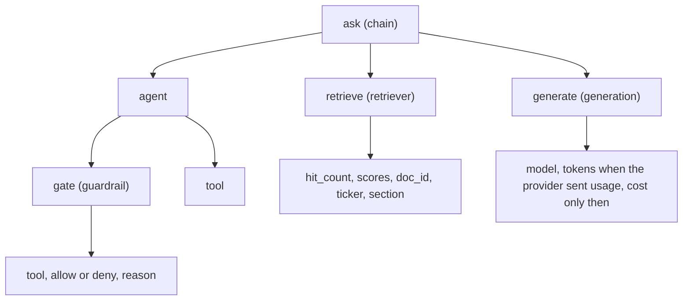

# capitalcite

**An evaluated, auditable RAG + agent system that answers questions about U.S. bank filings with citations, and fails closed when it can't back up an answer.**

> Status: 🚧 work in progress. Every number in this README marked **TBD** gets filled in from a real eval run. Nothing here is a projected or made-up result.

Banks can't use an LLM that guesses. `capitalcite` is built around three rules:
1. **Every claim has a source.** Answers cite the filing, section, and page or chunk they came from.
2. **Every change is measured.** Retrieval and answer quality are tracked with RAGAS/DeepEval against a golden set, and CI fails when quality drops.
3. **Every action goes through a gate.** Agent tool calls go through a fail-closed policy gate and get written to an append-only audit log.

---

## Architecture



## Features

| Area | What it does | Status |
|---|---|---|
| Ingestion | Pulls bank 10-K/10-Q filings from EDGAR (with a declared User-Agent and rate limits) plus regulatory PDFs; parses text and tables | 🟡 EDGAR 10-K/10-Q (`capitalcite ingest`); HTML/PDF parse in #3 |
| Chunking experiments | Compares fixed, recursive, and section-aware (10-K Item boundaries) chunking | 🟡 `capitalcite chunk --chunker fixed\|recursive\|section` |
| Embedding comparison | Local FastEmbed `bge-small` (`BAAI/bge-small-en-v1.5`) and `minilm`, plus `openai-small` when `OPENAI_API_KEY` is set. The committed matrix uses `bge-small`. `minilm` is UNVERIFIED. | 🟡 `bge-small` measured; other models UNVERIFIED |
| Hybrid search | BM25 and dense vectors in one Qdrant collection, fused with reciprocal rank fusion. `capitalcite index` builds it. `POST /search` returns scores and citations. Cross-encoder rerank waits for a measured eval. | 🟡 `capitalcite index`, `POST /search` |
| Structured answers | `POST /ask` returns an answer whose citations are copied from retrieved chunks, or a refusal. The model supplies a hit index and a quote. The server copies `doc_id`, `start`, `end`, `quote_start`, `quote_end`, `section`, and `source_url` only when that quote is a verbatim, non-trivial substring of the chunk and every answer figure appears in a cited quote. Weak retrieval or a named entity missing from the hits refuses before the model. `ASK_MODEL=fake` quotes the first hit and does not read `OPENAI_API_KEY`. | 🟡 `POST /ask` |
| Agent | `POST /ask` with `path=agent` runs a LangGraph plan → tools → synthesizer loop. The synthesizer is still `ask()` / `ground()` / `guard`. The plan and tool trace are on the response. Step and token budgets refuse instead of guessing. | 🟡 `POST /ask` `path=agent` |
| Tools | `search_filings`, `xbrl_fact`, `fdic_bankfind`, and `calculator`. Unknown names are denied. HTTP tools take an injected client so tests stay offline. | 🟡 agent tools |
| Fail-closed gate | JSON allow-list per tool with argument schemas and per-request budgets. Unknown names, invalid args, and a policy-load failure are denies. `capitalcite gate decide` prints the decision. Denied calls do not run. | 🟡 `capitalcite gate` |
| Audit log | Append-only, hash-chained JSONL of every gated tool call, plus a sibling head file so deleting the last line fails verify. The wrapper writes the gate decision before the tool runs and refuses with `audit unavailable` if that write fails. Records store the gate `decision` and `reason`. `trace_id` is `current_trace_id()` (UUID only when tracing is off). The chain is not keyed: anyone with write access can rebuild it. | 🟡 `capitalcite audit verify` |
| Observability | Optional Langfuse traces for retrieval, LLM calls, tool calls, gate decisions, and latency/cost. No-op without keys. | 🟡 `observation()` + `CAPITALCITE_TRACE_FILE` |
| Evals in CI | RAGAS/DeepEval and behavioral contract tests; the PR fails on regression past a set threshold | ⬜ planned |
| Deploy | Azure Container Apps (Bicep, scale-to-zero API, internal Qdrant). Live Azure `/health` is UNVERIFIED until someone opts in. | 🟡 IaC + image recipe |
| MCP server (optional) | Exposes `search_filings` / `ask` as MCP tools | ⬜ optional |
| Entity graph (optional) | Neo4j graph of bank → subsidiary → filing → metric | ⬜ optional |

## Evaluation

Golden set: **112** questions (v1). Handwritten items over the twelve ingested 10-Ks carry `start`/`end` spans in parsed `document.md` so later recall@k can join `Chunk.start`/`Chunk.end`. FinanceBench and FinQA tails are answer-scoring only (excluded from recall@k). See `evals/golden/README.md` and [docs/decisions/0004-golden-set.md](docs/decisions/0004-golden-set.md).

### Retrieval (per configuration)

<!-- BEGIN RETRIEVAL EVAL -->

| Chunking | Embedding | Retrieval | n | Recall@5 | MRR@5 | nDCG@5 | Recall@10 | MRR@10 | nDCG@10 |
|---|---|---|---:|---:|---:|---:|---:|---:|---:|
| section | fastembed:BAAI/bge-small-en-v1.5 | dense | 77 | 0.078 | 0.043 | 0.047 | 0.156 | 0.053 | 0.070 |
| section | fastembed:BAAI/bge-small-en-v1.5 | bm25 | 77 | 0.182 | 0.089 | 0.103 | 0.286 | 0.101 | 0.133 |
| section | fastembed:BAAI/bge-small-en-v1.5 | hybrid | 77 | 0.169 | 0.096 | 0.098 | 0.299 | 0.114 | 0.140 |
| fixed | fastembed:BAAI/bge-small-en-v1.5 | dense | 77 | 0.169 | 0.118 | 0.103 | 0.208 | 0.124 | 0.118 |
| fixed | fastembed:BAAI/bge-small-en-v1.5 | bm25 | 77 | 0.130 | 0.071 | 0.080 | 0.195 | 0.079 | 0.097 |
| fixed | fastembed:BAAI/bge-small-en-v1.5 | hybrid | 77 | 0.195 | 0.114 | 0.114 | 0.234 | 0.120 | 0.127 |
| section | — | hybrid + rerank | — | UNVERIFIED | UNVERIFIED | UNVERIFIED | UNVERIFIED | UNVERIFIED | UNVERIFIED |

Generated from `evals/results/8b63d12acd50.json` (sha `8b63d12acd50`, embedder `fastembed:BAAI/bge-small-en-v1.5`, sparse `fastembed:Qdrant/bm25:k1=1.2:b=0.75:avgdl=256.0`, fastembed `0.8.1`, qdrant-client `1.19.1`). Noise floor: n=77, one item is 0.013 recall. RAGAS context precision/recall is UNVERIFIED (no LLM key). minilm is UNVERIFIED (a second full embed is not cheap on this corpus).

<!-- END RETRIEVAL EVAL -->

### Answer quality

| System | Faithfulness | Answer relevancy | Numeric exact-match | Citation accuracy | Correct refusals |
|---|---|---|---|---|---|
| Plain RAG | TBD | TBD | TBD | TBD | TBD |
| Agent (plan-then-act) | TBD | TBD | TBD | TBD | TBD |

Faithfulness, relevancy, numeric exact-match, and citation accuracy stay UNVERIFIED until a live LLM eval writes them.

### Agent vs RAG (retrieval)

Comparison and multi-hop handwritten items. The agent row is the fake planner that searches each named ticker and year. It is not a live LLM.

<!-- BEGIN AGENT RAG EVAL -->

| System | n | Recall@5 | Recall@10 | Planner |
|---|---:|---:|---:|---|
| Plain RAG (section/hybrid) | 15 | 0.267 | 0.333 | — |
| Agent | 15 | 0.400 | 0.600 | fake/heuristic planner |

Comparison and multi-hop handwritten items only. Answer quality stays UNVERIFIED.

<!-- END AGENT RAG EVAL -->

### Gate & safety

| Test suite | Cases | Pass rate |
|---|---|---|
| Disallowed tool / arg injection attempts | 3 | 1.00 |
| Prompt injection inside retrieved docs | 2 | 1.00 |
| Audit log integrity (hash chain verify) | TBD | TBD |

### Latency & cost

| Path | p50 latency | p95 latency | Cost / query |
|---|---|---|---|
| RAG | TBD | TBD | TBD |
| Agent | TBD | TBD | TBD |
| Gate `decide()` | 0.005 ms | 0.006 ms | 0 |

> Methodology, model versions, and the commit SHA for each run are logged in `evals/results/<sha12>.json`. Tables are regenerated by `make eval-report`.

## Quickstart

```bash
git clone https://github.com/naveed949/capitalcite && cd capitalcite
cp .env.example .env          # set SEC_USER_AGENT="Your Name you@example.com"
docker compose up -d          # Qdrant :6333, Langfuse :3000
uv sync                       # Python 3.12
uv run uvicorn capitalcite.api:app --reload
curl -s localhost:8000/health
```

`GET /health` is served now. Ingest writes raw 10-K/10-Q primary documents under
`data/raw/edgar/` (gitignored) with sidecar metadata. `capitalcite chunk` parses
those files and writes cited chunks under `data/parsed/edgar/`. `capitalcite index`
embeds `chunks.jsonl` into Qdrant. `POST /search` returns ranked citations.
`POST /ask` returns a grounded answer or a refusal. `capitalcite eval` scores retrieval.

`EMBEDDER` selects the dense model. `bge-small` is the default and runs locally
with FastEmbed. `minilm` is the other local model. `openai-small` calls OpenAI
and reads `OPENAI_API_KEY`. `ASK_MODEL` selects the chat model for `POST /ask`.
`openai` is the default and reads the same key. `fake` quotes a retrieved chunk
and does not read the key. `ASK_OPENAI_MODEL` defaults to `gpt-4o-mini`.
Leave `OPENAI_API_KEY` empty for the local embedders and for `ASK_MODEL=fake`.

Without Docker, set `QDRANT_PATH` to a directory (or `QDRANT_URL=:memory:` in
one process). Index and `POST /search` must share that path. Compose Qdrant
is `qdrant/qdrant:v1.16.2` or newer; parameterized RRF needs server 1.16.

```bash
uv run capitalcite ingest --tickers JPM,BAC,WFC,C --forms 10-K --years 2023-2025
uv run capitalcite chunk --chunker section
uv run capitalcite index --chunker section --embedder bge-small
curl -s localhost:8000/search -H 'content-type: application/json' \
  -d '{"query":"What was JPMorgan CET1 ratio at year-end 2023?","mode":"hybrid","k":8,"ticker":"JPM","form":"10-K","period":"2023"}'
curl -s localhost:8000/ask -H 'content-type: application/json' \
  -d '{"question":"What was JPMorgan CET1 ratio at year-end 2023?","ticker":"JPM","form":"10-K","period":"2023","model":"fake"}'
curl -s localhost:8000/ask -H 'content-type: application/json' \
  -d '{"question":"Which bank had the higher Standardized CET1 at year-end 2024, JPMorgan or Bank of America?","path":"agent","model":"fake"}'
uv run capitalcite eval --suite golden   # writes evals/results/<sha12>.json
uv run capitalcite eval --suite golden --small   # FakeEmbedder, fixture corpus, no download
uv run capitalcite gate decide --tool shell --args '{"cmd":"ls"}'
uv run capitalcite audit verify --path data/audit.jsonl
```

Ingest design: [docs/decisions/0002-edgar-ingester.md](docs/decisions/0002-edgar-ingester.md).
Parse and chunk design: [docs/decisions/0003-parse-and-chunk.md](docs/decisions/0003-parse-and-chunk.md).
Golden set: [docs/decisions/0004-golden-set.md](docs/decisions/0004-golden-set.md).
Hybrid retrieval: [docs/decisions/0005-hybrid-retrieval.md](docs/decisions/0005-hybrid-retrieval.md).
Structured answers: [docs/decisions/0007-structured-ask.md](docs/decisions/0007-structured-ask.md).
Fail-closed tool gate: [docs/decisions/0009-fail-closed-tool-gate.md](docs/decisions/0009-fail-closed-tool-gate.md).
Plan-then-act agent: [docs/decisions/0008-plan-then-act-agent.md](docs/decisions/0008-plan-then-act-agent.md).
Langfuse tracing: [docs/decisions/0010-langfuse-tracing.md](docs/decisions/0010-langfuse-tracing.md).
Audit log: [docs/decisions/0011-append-only-audit-log.md](docs/decisions/0011-append-only-audit-log.md).
Azure Container Apps: [docs/decisions/0012-azure-container-apps.md](docs/decisions/0012-azure-container-apps.md).

### Observability

`POST /ask` and `capitalcite eval` emit a span tree when tracing is on.
Missing Langfuse keys, or `LANGFUSE_TRACING_ENABLED=false`, is a no-op.
The request still returns. Tests use an in-memory exporter. `verify.sh`
writes the same tree to `spans.jsonl` via `CAPITALCITE_TRACE_FILE`.

A live Langfuse UI screenshot needs compose on `:3000` or Langfuse Cloud.
That path is UNVERIFIED on a VM without Docker. The tree below is from
the in-memory exporter on `POST /ask` with `model` `fake`, not a Langfuse
UI capture.



Do not send chunk text, chat messages, or secrets. Attribute keys are an
allowlist. Question text is masked and truncated. Sampling is
`LANGFUSE_SAMPLE_RATE` on the root. A dropped root drops every child.

Low-RAM option: `docker compose up -d qdrant` and point `LANGFUSE_HOST` at Langfuse Cloud.

Azure is opt-in. `make infra-validate` compiles bootstrap and main Bicep.
`make bootstrap` is a one-shot Owner apply (identities, federated
credentials, every role assignment). `make deploy` and the Deploy Azure
workflow skip with UNVERIFIED when `az` or OIDC secrets are missing, and
the workflow never writes RBAC. Cost, roles, and secrets:
[infra/README.md](infra/README.md). Design:
[docs/decisions/0012-azure-container-apps.md](docs/decisions/0012-azure-container-apps.md).

Design choices for this scaffold: [docs/decisions/0001-scaffold.md](docs/decisions/0001-scaffold.md).

The running decision log is [docs/DECISIONS.md](docs/DECISIONS.md).

## Data sources

Everything below is public. Each link was checked on 2026-10-16.

| Source | What | Format / access | Use in this repo |
|---|---|---|---|
| [SEC EDGAR APIs](https://www.sec.gov/search-filings/edgar-application-programming-interfaces) | Filing history and XBRL facts for every filer (JPM, BAC, WFC, C…) | JSON REST on `data.sec.gov`, no key; nightly bulk ZIPs | Main corpus (10-K/10-Q), plus ground-truth numbers for golden answers via `companyfacts` |
| [EDGAR access rules](https://www.sec.gov/os/accessing-edgar-data) | Fair-access policy, index files, archive paths | Max 10 req/s, declared User-Agent required | The ingester follows these rules |
| [EDGAR full-text search](https://efts.sec.gov/LATEST/search-index?q=%22common%20equity%20tier%201%22&forms=10-K) | Phrase search across filings since 2001 | JSON endpoint | Finding filings with specific disclosures (CET1, CECL…) |
| [FDIC BankFind Suite API](https://banks.data.fdic.gov/docs/) | Institutions, financials, failures, branches, Summary of Deposits | JSON/CSV REST, OpenAPI spec, no key required now | Agent tool for structured bank facts |
| [FFIEC CDR bulk data](https://cdr.ffiec.gov/public/PWS/DownloadBulkData.aspx) | Call Reports and UBPR for all commercial banks | Tab-delimited or XBRL, quarterly | Structured financials, cross-checks |
| [FFIEC NIC](https://www.ffiec.gov/npw/) | Bank holding company structure and identifiers (RSSD, LEI, FDIC cert) | Web search and data downloads | Entity resolution and the Neo4j graph |
| [FR Y-9C form & instructions](https://www.federalreserve.gov/apps/reportingforms/Report/Index/FR_Y-9C) | BHC consolidated report forms and long instructions PDFs | PDF | Long regulatory text for chunking experiments |
| [Fed stress test archive](https://www.federalreserve.gov/supervisionreg/dfast-archive.htm) | DFAST results 2013–2026 | PDF/HTML | Cross-bank comparison questions |
| [Basel Framework (BIS)](https://www.bis.org/basel_framework/) | Consolidated Basel standards (CAP, RBC, LCR, DIS…) | HTML | Definitions corpus (what CET1/LCR mean) |
| [BofA Pillar 3](https://investor.bankofamerica.com/regulatory-and-other-filings/basel-pillar-3-disclosures) | Example U.S. G-SIB Pillar 3 capital and liquidity disclosures | PDF | Regulatory-disclosure documents |
| [OCC Comptroller's Handbook](https://www.occ.gov/publications-and-resources/publications/comptrollers-handbook/index-comptrollers-handbook.html) | Examiner handbooks (liquidity, credit, compliance) | PDF | Compliance and policy Q&A |
| [CFPB regulations](https://www.consumerfinance.gov/rules-policy/) | Consumer finance rules and recent actions | HTML/PDF | Compliance Q&A |
| [CFPB Complaint DB](https://www.consumerfinance.gov/data-research/consumer-complaints/) · [API](https://cfpb.github.io/api/ccdb/) | Consumer complaints about financial firms | CSV ZIP / JSON API | Optional: complaint triage/classification demo |
| [FinanceBench](https://huggingface.co/datasets/PatronusAI/financebench) | 150 open QA pairs with evidence over 10-K/10-Q filings | HF dataset (parquet) | Calibrating the eval harness against a published benchmark |
| [FinQA](https://huggingface.co/datasets/ibm-research/finqa) · [GitHub](https://github.com/czyssrs/FinQA) | About 8k numerical-reasoning QA pairs over financial reports (CC-BY-4.0) | JSON | Numeric-reasoning eval subset |

**Terms:** U.S. federal government works (SEC, FDIC, FFIEC, Fed, OCC, CFPB) are generally public domain, but SEC requires following its fair-access rules. BIS and bank-published documents keep their own copyright, so this repo links to them and does not redistribute them. Check each dataset's license on its card before redistributing derived data.

## Layout

```
src/capitalcite/     async FastAPI app, settings, CLI, ingest, parse, chunk, retrieval, ask, agent, gate, audit
tests/               pytest (recorded fixtures; no live network)
docs/DECISIONS.md    append-only index of architecture decisions
docs/decisions/      architecture decision records
evals/               golden set and results (issues #5 / #6)
data/                raw and parsed filings (gitignored contents)
docker-compose.yml   Qdrant + self-hosted Langfuse
Dockerfile           multi-stage API image (`ASK_MODEL=fake` by default)
infra/               bootstrap.bicep (identities + RBAC) and main.bicep (apps)
```

Tooling: `uv`, ruff, mypy, pytest. CI runs all three on every PR. A second
workflow compiles Bicep, builds the image, and runs gitleaks. It does not log
in to Azure.

## Roadmap

- [ ] **M1: RAG + evals foundation** (week 1): ingestion, chunking/embedding experiments, hybrid search, golden set, baseline eval tables
- [ ] **M2: Agent, gate, observability** (week 2): plan-then-act agent, structured outputs, fail-closed gate + audit log, Langfuse, eval regression CI
- [ ] **M3: Ship** (week 3): Azure Container Apps IaC (live apply UNVERIFIED), filled-in README eval tables, optional MCP server and Neo4j graph
- [ ] Later: multi-tenant document isolation, PII redaction, human-in-the-loop approvals for high-risk tools

See [MILESTONES.md](MILESTONES.md) for the full issue breakdown.

## Why I built this

I've spent 8 years shipping production systems that move money: wallets, bridges, and transaction monitoring. More recently I've been building agent infrastructure with fail-closed tool gates and sandboxes. This project brings both together: an AI system for banking documents where every answer is measured, cited, and auditable.

## License

MIT (code). Third-party documents and datasets keep their own licenses.
