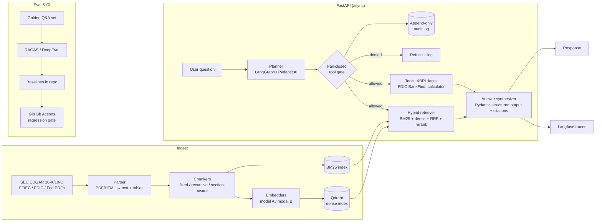

# capitalcite

**An evaluated, auditable RAG + agent system that answers questions about U.S. bank filings with citations, and fails closed when it can't back up an answer.**

> Status: 🚧 work in progress. Every number in this README marked **TBD** gets filled in from a real eval run. Nothing here is a projected or made-up result.

Banks can't use an LLM that guesses. `capitalcite` is built around three rules:
1. **Every claim has a source.** Answers cite the filing, section, and page or chunk they came from.
2. **Every change is measured.** Retrieval and answer quality are tracked with RAGAS/DeepEval against a golden set, and CI fails when quality drops.
3. **Every action goes through a gate.** Agent tool calls go through a fail-closed policy gate and get written to an append-only audit log.

---

## Architecture



## Features

| Area | What it does | Status |
|---|---|---|
| Ingestion | Pulls bank 10-K/10-Q filings from EDGAR (with a declared User-Agent and rate limits) plus regulatory PDFs; parses text and tables | 🟡 EDGAR 10-K/10-Q (`capitalcite ingest`); HTML/PDF parse in #3 |
| Chunking experiments | Compares fixed, recursive, and section-aware (10-K Item boundaries) chunking | 🟡 `capitalcite chunk --chunker fixed\|recursive\|section` |
| Embedding comparison | At least 2 embedding models, compared on the same golden set | ⬜ planned |
| Hybrid search | BM25 + dense vectors, fused with Reciprocal Rank Fusion, plus an optional cross-encoder rerank | ⬜ planned |
| Structured answers | Pydantic schemas: `answer`, `citations[]`, `confidence`, `refusal_reason` | ⬜ planned |
| Agent | Plan-then-act loop (LangGraph or PydanticAI) for multi-step questions, e.g. "compare CET1 ratios across JPM and BAC FY2025" | ⬜ planned |
| Tools | XBRL company-facts lookup, FDIC BankFind lookup, safe calculator | ⬜ planned |
| Fail-closed gate | Allow-list policy per tool, argument validation, budget limits; anything not explicitly allowed is denied | ⬜ planned |
| Audit log | Append-only, hash-chained JSONL of every tool call, decision, and input/output digest | ⬜ planned |
| Observability | Langfuse traces for retrieval, LLM calls, tool calls, and latency/cost | ⬜ planned |
| Evals in CI | RAGAS/DeepEval and behavioral contract tests; the PR fails on regression past a set threshold | ⬜ planned |
| Deploy | Azure Container Apps | ⬜ planned |
| MCP server (optional) | Exposes `search_filings` / `ask` as MCP tools | ⬜ optional |
| Entity graph (optional) | Neo4j graph of bank → subsidiary → filing → metric | ⬜ optional |

## Evaluation

Golden set: **108** questions (v1). It's built from hand-written questions over bank filings, plus a filtered subset of FinanceBench and FinQA for calibration. See `evals/golden/README.md` for how each item was made and checked.

### Retrieval (per configuration)

| Chunking | Embedding | Retrieval | Recall@5 | MRR@10 | Context precision | Context recall |
|---|---|---|---|---|---|---|
| fixed-512 | TBD | dense | TBD | TBD | TBD | TBD |
| recursive | TBD | dense | TBD | TBD | TBD | TBD |
| section-aware | TBD | dense | TBD | TBD | TBD | TBD |
| section-aware | TBD | BM25 | TBD | TBD | TBD | TBD |
| section-aware | TBD | hybrid (RRF) | TBD | TBD | TBD | TBD |
| section-aware | TBD | hybrid + rerank | TBD | TBD | TBD | TBD |

### Answer quality

| System | Faithfulness | Answer relevancy | Numeric exact-match | Citation accuracy | Correct refusals |
|---|---|---|---|---|---|
| Plain RAG | TBD | TBD | TBD | TBD | TBD |
| Agent (plan-then-act) | TBD | TBD | TBD | TBD | TBD |

### Gate & safety

| Test suite | Cases | Pass rate |
|---|---|---|
| Disallowed tool / arg injection attempts | TBD | TBD |
| Prompt injection inside retrieved docs | TBD | TBD |
| Audit log integrity (hash chain verify) | TBD | TBD |

### Latency & cost

| Path | p50 latency | p95 latency | Cost / query |
|---|---|---|---|
| RAG | TBD | TBD | TBD |
| Agent | TBD | TBD | TBD |

> Methodology, model versions, and the commit SHA for each run will be logged in `evals/results/`. Tables get regenerated by `make eval-report`.

## Quickstart

```bash
git clone https://github.com/naveed949/capitalcite && cd capitalcite
cp .env.example .env          # set SEC_USER_AGENT="Your Name you@example.com"
docker compose up -d          # Qdrant :6333, Langfuse :3000
uv sync                       # Python 3.12
uv run uvicorn capitalcite.api:app --reload
curl -s localhost:8000/health
```

`GET /health` is served now. Ingest writes raw 10-K/10-Q primary documents under
`data/raw/edgar/` (gitignored) with sidecar metadata. `capitalcite chunk` parses
those files and writes cited chunks under `data/parsed/edgar/`. Index, `/ask`,
and eval land in later issues:

```bash
uv run capitalcite ingest --tickers JPM,BAC,WFC,C --forms 10-K --years 2023-2025
uv run capitalcite chunk --chunker section
uv run capitalcite index --chunker section --embedder <model>
curl -s localhost:8000/ask -d '{"q":"What was JPMorgan’s CET1 ratio at year-end 2025?"}' | jq
uv run capitalcite eval --suite golden   # writes evals/results/<sha>.json
```

Ingest design: [docs/decisions/0002-edgar-ingester.md](docs/decisions/0002-edgar-ingester.md).
Parse and chunk design: [docs/decisions/0003-parse-and-chunk.md](docs/decisions/0003-parse-and-chunk.md).

Low-RAM option: `docker compose up -d qdrant` and point `LANGFUSE_HOST` at Langfuse Cloud.

Design choices for this scaffold: [docs/decisions/0001-scaffold.md](docs/decisions/0001-scaffold.md).

The running decision log is [docs/DECISIONS.md](docs/DECISIONS.md).

## Data sources

Everything below is public. Each link was checked on 2026-10-16.

| Source | What | Format / access | Use in this repo |
|---|---|---|---|
| [SEC EDGAR APIs](https://www.sec.gov/search-filings/edgar-application-programming-interfaces) | Filing history and XBRL facts for every filer (JPM, BAC, WFC, C…) | JSON REST on `data.sec.gov`, no key; nightly bulk ZIPs | Main corpus (10-K/10-Q), plus ground-truth numbers for golden answers via `companyfacts` |
| [EDGAR access rules](https://www.sec.gov/os/accessing-edgar-data) | Fair-access policy, index files, archive paths | Max 10 req/s, declared User-Agent required | The ingester follows these rules |
| [EDGAR full-text search](https://efts.sec.gov/LATEST/search-index?q=%22common%20equity%20tier%201%22&forms=10-K) | Phrase search across filings since 2001 | JSON endpoint | Finding filings with specific disclosures (CET1, CECL…) |
| [FDIC BankFind Suite API](https://banks.data.fdic.gov/docs/) | Institutions, financials, failures, branches, Summary of Deposits | JSON/CSV REST, OpenAPI spec, no key required now | Agent tool for structured bank facts |
| [FFIEC CDR bulk data](https://cdr.ffiec.gov/public/PWS/DownloadBulkData.aspx) | Call Reports and UBPR for all commercial banks | Tab-delimited or XBRL, quarterly | Structured financials, cross-checks |
| [FFIEC NIC](https://www.ffiec.gov/npw/) | Bank holding company structure and identifiers (RSSD, LEI, FDIC cert) | Web search and data downloads | Entity resolution and the Neo4j graph |
| [FR Y-9C form & instructions](https://www.federalreserve.gov/apps/reportingforms/Report/Index/FR_Y-9C) | BHC consolidated report forms and long instructions PDFs | PDF | Long regulatory text for chunking experiments |
| [Fed stress test archive](https://www.federalreserve.gov/supervisionreg/dfast-archive.htm) | DFAST results 2013–2026 | PDF/HTML | Cross-bank comparison questions |
| [Basel Framework (BIS)](https://www.bis.org/basel_framework/) | Consolidated Basel standards (CAP, RBC, LCR, DIS…) | HTML | Definitions corpus (what CET1/LCR mean) |
| [BofA Pillar 3](https://investor.bankofamerica.com/regulatory-and-other-filings/basel-pillar-3-disclosures) | Example U.S. G-SIB Pillar 3 capital and liquidity disclosures | PDF | Regulatory-disclosure documents |
| [OCC Comptroller's Handbook](https://www.occ.gov/publications-and-resources/publications/comptrollers-handbook/index-comptrollers-handbook.html) | Examiner handbooks (liquidity, credit, compliance) | PDF | Compliance and policy Q&A |
| [CFPB regulations](https://www.consumerfinance.gov/rules-policy/) | Consumer finance rules and recent actions | HTML/PDF | Compliance Q&A |
| [CFPB Complaint DB](https://www.consumerfinance.gov/data-research/consumer-complaints/) · [API](https://cfpb.github.io/api/ccdb/) | Consumer complaints about financial firms | CSV ZIP / JSON API | Optional: complaint triage/classification demo |
| [FinanceBench](https://huggingface.co/datasets/PatronusAI/financebench) | 150 open QA pairs with evidence over 10-K/10-Q filings | HF dataset (parquet) | Calibrating the eval harness against a published benchmark |
| [FinQA](https://huggingface.co/datasets/ibm-research/finqa) · [GitHub](https://github.com/czyssrs/FinQA) | About 8k numerical-reasoning QA pairs over financial reports (CC-BY-4.0) | JSON | Numeric-reasoning eval subset |

**Terms:** U.S. federal government works (SEC, FDIC, FFIEC, Fed, OCC, CFPB) are generally public domain, but SEC requires following its fair-access rules. BIS and bank-published documents keep their own copyright, so this repo links to them and does not redistribute them. Check each dataset's license on its card before redistributing derived data.

## Layout

```
src/capitalcite/     async FastAPI app, settings, CLI, ingest, parse, chunk
tests/               pytest (recorded fixtures; no live network)
docs/DECISIONS.md    append-only index of architecture decisions
docs/decisions/      architecture decision records
evals/               golden set and results (issues #5 / #6)
data/                raw and parsed filings (gitignored contents)
docker-compose.yml   Qdrant + self-hosted Langfuse
```

Tooling: `uv`, ruff, mypy, pytest. CI runs all three on every PR.

## Roadmap

- [ ] **M1: RAG + evals foundation** (week 1): ingestion, chunking/embedding experiments, hybrid search, golden set, baseline eval tables
- [ ] **M2: Agent, gate, observability** (week 2): plan-then-act agent, structured outputs, fail-closed gate + audit log, Langfuse, eval regression CI
- [ ] **M3: Ship** (week 3): Azure Container Apps, filled-in README eval tables, optional MCP server and Neo4j graph
- [ ] Later: multi-tenant document isolation, PII redaction, human-in-the-loop approvals for high-risk tools

See [MILESTONES.md](MILESTONES.md) for the full issue breakdown.

## Why I built this

I've spent 8 years shipping production systems that move money: wallets, bridges, and transaction monitoring. More recently I've been building agent infrastructure with fail-closed tool gates and sandboxes. This project brings both together: an AI system for banking documents where every answer is measured, cited, and auditable.

## License

MIT (code). Third-party documents and datasets keep their own licenses.
