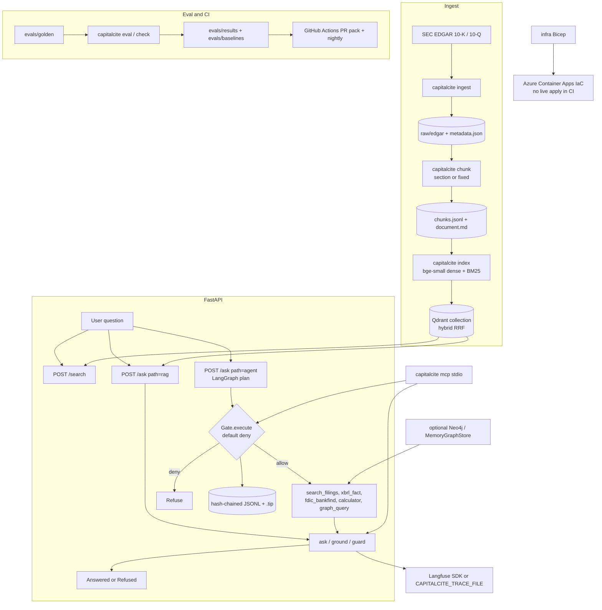

# capitalcite

An evaluated, auditable RAG and agent system that answers questions about U.S. bank filings with citations, and fails closed when it cannot back an answer.

Banks cannot use an LLM that guesses. This repo is built around three rules.

1. **Every claim has a source.** Answers cite the filing, section, and span they came from.
2. **Every change is measured.** Retrieval quality is span-overlap recall@k against a golden set. CI fails when a tracked rate drops.
3. **Every action goes through a gate.** Agent and MCP tool calls hit a default-deny policy and an append-only audit log.

Numbers in the tables below come from JSON under [`evals/results/`](evals/results/) written in this run. A cell this run could not produce is **UNVERIFIED** plus a reason, not a guessed value. See [`evals/results/7388ac3eea43-unverified.json`](evals/results/7388ac3eea43-unverified.json).

## Demo

Terminal recording of the fake-model path. Fixture corpus, local `bge-small`, embedded Qdrant, `ASK_MODEL=fake`. No API key. No Docker.

The recording is [`docs/demo/quickstart.cast`](docs/demo/quickstart.cast). Replay it with `asciinema play docs/demo/quickstart.cast`. Re-record with [`docs/demo/record.sh`](docs/demo/record.sh), which runs [`docs/demo/quickstart.sh`](docs/demo/quickstart.sh).

## Architecture



MCP `search_filings` and `ask` use the same gate, audit log, and `ground()` path as HTTP. `graph_query` is a tool. Blank `NEO4J_URI` leaves `retrieve()` unchanged. There is no reranker and no PydanticAI on this path. RAGAS is not wired.

## Evaluation

Golden set: **112** questions (v1). Handwritten items over the twelve ingested 10-Ks carry `start`/`end` spans in parsed `document.md`. FinanceBench and FinQA tails are answer-scoring only and stay out of recall@k. See [`evals/golden/README.md`](evals/golden/README.md) and [ADR 0004](docs/decisions/0004-golden-set.md).

### Retrieval (per configuration)

Twelve 10-Ks, FastEmbed `bge-small`, span-overlap on 77 handwritten items. `--small` on the fixture HTML is a different condition and is not this table ([`7388ac3eea43-small.json`](evals/results/7388ac3eea43-small.json), all Recall@5 = 0.000 because those excerpts do not contain the gold spans).

<!-- BEGIN RETRIEVAL EVAL -->

| Chunking | Embedding | Retrieval | n | Recall@5 | MRR@5 | nDCG@5 | Recall@10 | MRR@10 | nDCG@10 |
|---|---|---|---:|---:|---:|---:|---:|---:|---:|
| section | fastembed:BAAI/bge-small-en-v1.5 | dense | 77 | 0.078 | 0.043 | 0.047 | 0.156 | 0.053 | 0.070 |
| section | fastembed:BAAI/bge-small-en-v1.5 | bm25 | 77 | 0.182 | 0.089 | 0.103 | 0.286 | 0.101 | 0.133 |
| section | fastembed:BAAI/bge-small-en-v1.5 | hybrid | 77 | 0.169 | 0.096 | 0.098 | 0.299 | 0.114 | 0.140 |
| fixed | fastembed:BAAI/bge-small-en-v1.5 | dense | 77 | 0.169 | 0.118 | 0.103 | 0.208 | 0.124 | 0.118 |
| fixed | fastembed:BAAI/bge-small-en-v1.5 | bm25 | 77 | 0.130 | 0.071 | 0.080 | 0.195 | 0.079 | 0.097 |
| fixed | fastembed:BAAI/bge-small-en-v1.5 | hybrid | 77 | 0.195 | 0.114 | 0.114 | 0.234 | 0.120 | 0.127 |
| section | - | hybrid + rerank | - | UNVERIFIED | UNVERIFIED | UNVERIFIED | UNVERIFIED | UNVERIFIED | UNVERIFIED |

Generated from [`evals/results/7388ac3eea43.json`](evals/results/7388ac3eea43.json) (sha `7388ac3eea43`, embedder `fastembed:BAAI/bge-small-en-v1.5`, sparse `fastembed:Qdrant/bm25:k1=1.2:b=0.75:avgdl=256.0`, fastembed `0.8.1`, qdrant-client `1.19.1`). Noise floor: n=77, one item is 0.013 recall. RAGAS context precision/recall is UNVERIFIED (no LLM key). minilm is UNVERIFIED (a second full embed is not cheap on this corpus).

<!-- END RETRIEVAL EVAL -->

Every retrieval cell in that table comes from [`evals/results/7388ac3eea43.json`](evals/results/7388ac3eea43.json).

### Answer quality

| System | Faithfulness | Answer relevancy | Numeric exact-match | Citation accuracy | Correct refusals |
|---|---|---|---|---|---|
| Plain RAG | [UNVERIFIED](evals/results/7388ac3eea43-unverified.json) | [UNVERIFIED](evals/results/7388ac3eea43-unverified.json) | [UNVERIFIED](evals/results/7388ac3eea43-unverified.json) | [UNVERIFIED](evals/results/7388ac3eea43-unverified.json) | [UNVERIFIED](evals/results/7388ac3eea43-unverified.json) |
| Agent (plan-then-act) | [UNVERIFIED](evals/results/7388ac3eea43-unverified.json) | [UNVERIFIED](evals/results/7388ac3eea43-unverified.json) | [UNVERIFIED](evals/results/7388ac3eea43-unverified.json) | [UNVERIFIED](evals/results/7388ac3eea43-unverified.json) | [UNVERIFIED](evals/results/7388ac3eea43-unverified.json) |

`OPENAI_API_KEY` was empty. RAGAS and DeepEval did not run. `capitalcite check --live` skipped. The fake-model contract in [`7388ac3eea43-check.json`](evals/results/7388ac3eea43-check.json) answered `cc-ci-002` and refused `cc-u-001`. That is a cite/refuse contract, not a faithfulness rate.

### Agent vs RAG (retrieval)

Comparison and multi-hop handwritten items. The agent row is the fake planner that searches each named ticker and year. It is not a live LLM.

<!-- BEGIN AGENT RAG EVAL -->

| System | n | Recall@5 | Recall@10 | Planner |
|---|---:|---:|---:|---|
| Plain RAG (section/hybrid) | 15 | 0.267 | 0.333 | - |
| Agent | 15 | 0.400 | 0.600 | fake/heuristic planner |

Comparison and multi-hop handwritten items only. Answer quality stays UNVERIFIED.

<!-- END AGENT RAG EVAL -->

Source: [`evals/results/7388ac3eea43.json`](evals/results/7388ac3eea43.json). `--small` on the fixture HTML is not this table.

### Entity graph vs fixture-corpus substring

Questions that need a BHC → subsidiary or RSSD join. Not in the 77-item filing-span matrix.

<!-- BEGIN GRAPH EVAL -->

| System | n | Hit rate |
|---|---:|---:|
| Fixture-corpus substring | 6 | 0.000 |
| graph_query (memory snapshot) | 6 | 1.000 |

Delta (graph minus fixture substring) = 1.000. Generated from [`evals/results/7388ac3eea43-graph.json`](evals/results/7388ac3eea43-graph.json). Fixture-corpus substring is 1 only when every expected token is in the --small HTML. Those files do not contain the RSSDs. These items need entity traversal. They are not in the 77-item filing-span matrix.

<!-- END GRAPH EVAL -->

### Gate and safety

| Test suite | Cases | Pass rate |
|---|---|---|
| Disallowed tool / arg injection attempts | [3](evals/results/7388ac3eea43-gate.json) | [1.00](evals/results/7388ac3eea43-gate.json) |
| Prompt injection inside retrieved docs | [2](evals/results/7388ac3eea43-gate.json) | [1.00](evals/results/7388ac3eea43-gate.json) |
| Audit log integrity (hash chain verify) | [3](evals/results/7388ac3eea43-audit.json) | [1.00](evals/results/7388ac3eea43-audit.json) |
| CI contract pack (`capitalcite check`) | [2 cite/refuse + 5 red-team](evals/results/7388ac3eea43-check.json) | [1.00](evals/results/7388ac3eea43-check.json) |

`capitalcite check` also gates quote-index sanity (36/77) and fixture span-overlap (3/3) against [`evals/baselines/ci.json`](evals/baselines/ci.json) at zero item drop. Live OpenAI is `--live` and UNVERIFIED without `OPENAI_API_KEY`. Nightly live-corpus section/hybrid Recall@5 vs [`evals/baselines/nightly.json`](evals/baselines/nightly.json) allows one item of rank-boundary noise. Baseline file edits need the `eval-baseline` label.

### Latency and cost

| Path | p50 latency | p95 latency | Cost / query |
|---|---|---|---|
| RAG (`ASK_MODEL=fake`) | [14 ms](evals/results/7388ac3eea43-latency.json) | [16 ms](evals/results/7388ac3eea43-latency.json) | [0](evals/results/7388ac3eea43-unverified.json) |
| Agent (`ASK_MODEL=fake`) | [21 ms](evals/results/7388ac3eea43-latency.json) | [21 ms](evals/results/7388ac3eea43-latency.json) | [0](evals/results/7388ac3eea43-unverified.json) |
| Gate `decide()` | [0.018 ms](evals/results/7388ac3eea43-gate.json) | [0.020 ms](evals/results/7388ac3eea43-gate.json) | [0](evals/results/7388ac3eea43-gate.json) |

RAG and agent are 10 timed `POST /ask` calls after one warmup on the 12-point fixture index, `ASK_MODEL=fake`, this 4-core VM. Median / 95th percentile. One RAG sample was 75 ms (max, not p95). The limiter is retrieve plus JSON on one process, not the gate. Live OpenAI latency and cost stay UNVERIFIED. Gate numbers are `capitalcite gate bench --n 2000`.

Rewrite the retrieval and agent-vs-RAG blocks from the twelve-filing JSON:

```bash
uv run capitalcite eval --suite golden --from-results evals/results/7388ac3eea43.json --readme README.md
```

Do not point `--from-results` at the whole `evals/results/` directory. `*-small.json` would overwrite the table with fixture zeros.

## Tradeoffs and what I'd do next

This section is the interview argument. The ADRs hold the longer form.

### Chunking: section vs fixed

A 10-K is a book with labeled chapters. Item 7 is MD&A. Item 8 is the financials. A CET1 question is almost always answered inside one Item, often next to a table.

A fixed window of 512 tokens with 64 tokens of overlap is easy to reproduce. It is also blind. It will cut a markdown table in half. It will start in Item 7 and end in Item 8. The overlap saves a sentence on the cut. It does not restore the Item boundary.

Section-aware splitting cuts on Item headings first. An Item that fits the budget stays one chunk. An Item that does not is split with the recursive splitter, and every piece keeps that Item name. Tables are atomic. A table that overflows is split on row boundaries with the header repeated so each piece is still valid markdown.

Both chunkers are scored on the same 77 spanned items. The label is span overlap on `document.md`, not the section string. n=77 means one item is 0.013 recall. A 0.02 gap is noise. This run: section/hybrid Recall@5 = 0.169, fixed/hybrid = 0.195 ([`7388ac3eea43.json`](evals/results/7388ac3eea43.json)). That is two items. Do not rank the chunkers on it. Section BM25 at 0.182 vs section dense at 0.078 is eight items and is the one gap that survives the noise floor.

Recursive splitting exists in the CLI. It is not a third default arm. That would be another re-chunk and another embed of 12k-plus points.

**Next.** Measure late chunking (embed bigger windows, split only the hits you show the model) against this section/fixed matrix. Keep tables atomic. Do not add a chunker that is not an eval arm.

### Hybrid search: BM25, dense, RRF, no reranker

Dense search places a chunk near paraphrases. It misses a rare token the question names exactly when the HNSW walk never visits that point. BM25 does the opposite. It scores term frequency, rarity, and length. It will not find a paraphrase that shares no tokens.

Those scores are not in the same unit. A weighted sum needs a weight we have not measured. Reciprocal rank fusion ignores the raw scores and adds `1 / (k + rank)` per list. `RRF_K` defaults to 60, the Cormack constant. Qdrant's rank index starts at 0, so a first-place hit on one leg scores `1/k`. We pass Qdrant's `k`, not `k+1`.

A cross-encoder could repair a fusion miss. It also downloads another model and adds latency on every search. This repo has not measured that gain. `retrieve()` returns Qdrant's order truncated to `k`. The hybrid+rerank row stays UNVERIFIED until an eval writes it. A setting with one legal value would be a second way to say the same thing.

The first BM25 matrix in this project was hashed term counts plus IDF (TF-IDF). Section BM25 Recall@5 was 0. Production now uses FastEmbed `Qdrant/bm25` (`k1=1.2`, `b=0.75`, `avgdl=256`). `sparse_id` sits inside `IndexConfig` so a hashed-count collection cannot be reused as BM25.

**Next.** One rerank arm on the same 77 items, with p95 latency next to Recall@5. If the lift is inside the 0.013 noise floor, leave rerank off.

### Gate: default-deny, extra keys, audit hash chain

The planner is untrusted. `ToolCall.name` is a string. The policy file is the allow-list, not `TOOL_NAMES` in Python. Default is deny. An unknown name, extra keys on a known tool, a broken policy file, or a failed audit write never calls the runner.

Extra keys matter for MCP. The stock MCP SDK drops unknown fields before the handler runs. That would turn `{"query":"x","cmd":"ls"}` into an allow. This server overrides `call_tool` so the raw object reaches `Gate.decide`. `invalid_args` is the deny.

The audit log is a hash-chained JSONL plus a sibling `.tip`. Each record stores `prev_hash`. Genesis is 64 zero hex characters. A mutated field fails the hash. A deleted last line fails the tip. The wrapper writes the gate decision before the tool runs. A failed write is `audit unavailable`, not a silent skip. The chain is not HMAC-keyed. Anyone with write access can rebuild it. That is a stated limit, not an accident.

This run: 5/5 red-team cases passed ([`7388ac3eea43-gate.json`](evals/results/7388ac3eea43-gate.json)). Intact / tamper / truncated-last verify was 3/3 ([`7388ac3eea43-audit.json`](evals/results/7388ac3eea43-audit.json)). `decide()` p95 was 0.020 ms on 2000 samples.

**Next.** Key the chain (HMAC) or put the log in a store the API identity cannot truncate. Measure that against the current JSONL, which needs no Docker.

### Agent vs RAG, and graph as a tool

`path=rag` is one retrieve then `ask()` / `ground()` / `guard`. `path=agent` is LangGraph plan → gated tools → the same synthesizer. The agent does not get a second way to emit an answer. A hallucinated figure after four successful searches is still a refusal.

On comparison and multi-hop items the fake planner searches each named ticker and year. That is more retrieves, not a smarter generator. This run, n=15, section/hybrid: RAG Recall@5 = 0.267, agent = 0.400 ([`7388ac3eea43.json`](evals/results/7388ac3eea43.json)). The table is retrieval only. Answer quality stays UNVERIFIED without a live LLM.

Hybrid search ranks passages that are close in wording or embedding space. It loses on identity joins: parent to subsidiary, ticker to RSSD. Reciprocal rank fusion cannot walk `PARENT_OF`. `graph_query` is a fifth tool with a typed `kind` enum, not Cypher from the model. Blank `NEO4J_URI` returns `graph not configured` and leaves the 77-item baseline alone. This run's graph suite is 1.000 exact on the memory snapshot vs 0.000 substring hit on the fixture HTML ([`7388ac3eea43-graph.json`](evals/results/7388ac3eea43-graph.json)).

**Next.** A live planner vs the fake planner on those 15 items, with the same `ground()` checks. Do not fuse graph neighbors into every `retrieve()`.

## Local quickstart (fake model)

This path does not call OpenAI and does not need Docker. It chunks the checked-in fixture 10-K excerpts, indexes them with local FastEmbed `bge-small` into embedded Qdrant, and answers with `ASK_MODEL=fake`. Time from a fresh clone to `GET /health` plus search / ask / agent / gate deny must stay under 15 minutes.

```bash
git clone https://github.com/naveed949/capitalcite && cd capitalcite
# uv: curl -LsSf https://astral.sh/uv/install.sh | sh
uv sync --frozen
cp .env.example .env
```

In `.env`, set all of the following. Leave `OPENAI_API_KEY` empty.

```bash
SEC_USER_AGENT="Your Name you@example.com"
ASK_MODEL=fake
QDRANT_PATH=data/qdrant
LANGFUSE_TRACING_ENABLED=false
```

`QDRANT_PATH` wins over `QDRANT_URL`. Do not use `QDRANT_URL=:memory:` here. The CLI and uvicorn cannot share that store.

```bash
uv run capitalcite chunk --input-dir tests/fixtures/chunking/corpus --output-dir data --chunker section
uv run capitalcite index --input-dir data --chunker section --embedder bge-small
uv run uvicorn capitalcite.api:app --host 127.0.0.1 --port 8000
```

In another terminal:

```bash
curl -s localhost:8000/health
curl -s localhost:8000/search -H 'content-type: application/json' \
  -d '{"query":"What CET1 ratio did JPMorgan disclose?","mode":"hybrid","k":3,"ticker":"JPM"}'
curl -s localhost:8000/ask -H 'content-type: application/json' \
  -d '{"question":"What CET1 ratio did JPMorgan disclose?","ticker":"JPM","model":"fake"}'
curl -s localhost:8000/ask -H 'content-type: application/json' \
  -d '{"question":"What CET1 ratio did JPMorgan disclose for 2024?","path":"agent","model":"fake"}'
uv run capitalcite gate decide --tool shell --args '{"cmd":"ls"}'
```

The first `index` downloads FastEmbed `bge-small` (about 67 MB) and the BM25 vocab. Later runs reuse the cache. The same commands live in [`docs/demo/quickstart.sh`](docs/demo/quickstart.sh).

`GET /health` does not talk to Qdrant. Search and ask need the index and the same `QDRANT_PATH` as uvicorn.

## Optional paths

**Live EDGAR corpus.** `uv run capitalcite ingest --tickers JPM,BAC,WFC,C --forms 10-K --years 2023-2025` then `chunk` / `index` without `--input-dir tests/fixtures/...`. Exit 2 is UNVERIFIED (EDGAR 403/429/5xx), not a pass.

**Compose Qdrant and Langfuse.** `docker compose up -d` then leave `QDRANT_PATH` empty so the client dials `http://localhost:6333`. Compose Qdrant must be 1.16 or newer for parameterized RRF. This VM had no Docker, so that path is UNVERIFIED.

**Live OpenAI.** Set `OPENAI_API_KEY` and `ASK_MODEL=openai`. Without a key, `model` `openai` returns HTTP 503.

**Graph.** `uv run capitalcite graph load --backend memory` then `uv run capitalcite graph query --kind subsidiaries --ticker JPM`. Live Bolt needs `NEO4J_URI` and `docker compose --profile graph`. UNVERIFIED here.

**MCP.** `uv run capitalcite mcp` speaks JSON-RPC on stdio. stdout is the wire. Logs go to stderr.

**Eval and CI.** `uv run capitalcite eval --suite golden --small` (FakeEmbedder, no download). `uv run capitalcite check` vs [`evals/baselines/ci.json`](evals/baselines/ci.json). Full twelve-filing matrix: `QDRANT_PATH=... uv run capitalcite eval --suite golden --embedder bge-small`.

**Azure.** `make infra-validate` compiles Bicep. `make deploy` is UNVERIFIED without `az` login. Design: [ADR 0012](docs/decisions/0012-azure-container-apps.md). Cost and roles: [`infra/README.md`](infra/README.md).

Ingest design: [ADR 0002](docs/decisions/0002-edgar-ingester.md).
Parse and chunk: [ADR 0003](docs/decisions/0003-parse-and-chunk.md).
Golden set: [ADR 0004](docs/decisions/0004-golden-set.md).
Hybrid retrieval: [ADR 0005](docs/decisions/0005-hybrid-retrieval.md).
Retrieval eval: [ADR 0006](docs/decisions/0006-retrieval-eval.md).
Structured answers: [ADR 0007](docs/decisions/0007-structured-ask.md).
Plan-then-act agent: [ADR 0008](docs/decisions/0008-plan-then-act-agent.md).
Fail-closed tool gate: [ADR 0009](docs/decisions/0009-fail-closed-tool-gate.md).
Langfuse tracing: [ADR 0010](docs/decisions/0010-langfuse-tracing.md).
Audit log: [ADR 0011](docs/decisions/0011-append-only-audit-log.md).
Azure Container Apps: [ADR 0012](docs/decisions/0012-azure-container-apps.md).
Regression CI: [ADR 0013](docs/decisions/0013-eval-regression-ci.md).
Optional entity graph: [ADR 0014](docs/decisions/0014-optional-entity-graph.md).
MCP server: [ADR 0015](docs/decisions/0015-mcp-server.md).
This README: [ADR 0016](docs/decisions/0016-readme-demo.md).

The running decision log is [docs/DECISIONS.md](docs/DECISIONS.md).

## Features

| Area | What it does | Status |
|---|---|---|
| Ingestion | Pulls bank 10-K/10-Q filings from EDGAR with a declared User-Agent and rate limits | `capitalcite ingest` |
| Chunking | Fixed, recursive, or section-aware (10-K Item boundaries) | `capitalcite chunk --chunker fixed\|recursive\|section` |
| Embedding | Local FastEmbed `bge-small` (default) and `minilm`, plus `openai-small` when `OPENAI_API_KEY` is set | `bge-small` measured; minilm UNVERIFIED |
| Hybrid search | BM25 and dense vectors in one Qdrant collection, fused with RRF. `POST /search` returns scores and citations | `capitalcite index`, `POST /search` |
| Structured answers | `POST /ask` returns a citation copied from a retrieved chunk, or a refusal. `ASK_MODEL=fake` does not read `OPENAI_API_KEY` | `POST /ask` |
| Agent | `POST /ask` `path=agent` runs LangGraph plan → tools → the same `ask()` / `ground()` / `guard` | `POST /ask` `path=agent` |
| Tools | `search_filings`, `xbrl_fact`, `fdic_bankfind`, `calculator`, `graph_query`. Unknown names are denied | agent tools |
| Fail-closed gate | JSON allow-list. Unknown names, extra keys, and a policy-load failure are denies | `capitalcite gate` |
| Audit log | Append-only hash-chained JSONL plus a sibling tip. Write before the tool runs | `capitalcite audit verify` |
| Observability | Optional Langfuse trees. File exporter via `CAPITALCITE_TRACE_FILE`. No-op without keys | `observation()` |
| Evals in CI | `capitalcite check` on every PR. Nightly twelve-filing section/hybrid vs `evals/baselines/nightly.json` | `capitalcite check` |
| Deploy | Azure Container Apps Bicep. Live `/health` is UNVERIFIED until someone opts in | IaC + image recipe |
| MCP server | `capitalcite mcp` stdio. `search_filings` and `ask` go through the same gate | `capitalcite mcp` |
| Entity graph | BHC → subsidiary → filing → metric. Memory store in tests. Live Bolt UNVERIFIED without Docker | `capitalcite graph` |

## Data sources

Everything below is public. Each link was checked on 2026-10-16.

| Source | What | Format / access | Use in this repo |
|---|---|---|---|
| [SEC EDGAR APIs](https://www.sec.gov/search-filings/edgar-application-programming-interfaces) | Filing history and XBRL facts for every filer (JPM, BAC, WFC, C…) | JSON REST on `data.sec.gov`, no key; nightly bulk ZIPs | Main corpus (10-K/10-Q), plus ground-truth numbers for golden answers via `companyfacts` |
| [EDGAR access rules](https://www.sec.gov/os/accessing-edgar-data) | Fair-access policy, index files, archive paths | Max 10 req/s, declared User-Agent required | The ingester follows these rules |
| [EDGAR full-text search](https://efts.sec.gov/LATEST/search-index?q=%22common%20equity%20tier%201%22&forms=10-K) | Phrase search across filings since 2001 | JSON endpoint | Finding filings with specific disclosures (CET1, CECL…) |
| [FDIC BankFind Suite API](https://banks.data.fdic.gov/docs/) | Institutions, financials, failures, branches, Summary of Deposits | JSON/CSV REST, OpenAPI spec, no key required now | Agent tool for structured bank facts |
| [FFIEC CDR bulk data](https://cdr.ffiec.gov/public/PWS/DownloadBulkData.aspx) | Call Reports and UBPR for all commercial banks | Tab-delimited or XBRL, quarterly | Structured financials, cross-checks |
| [FFIEC NIC](https://www.ffiec.gov/npw/) | Bank holding company structure and identifiers (RSSD, LEI, FDIC cert) | Web search and data downloads | Entity resolution and the Neo4j graph |
| [FR Y-9C form and instructions](https://www.federalreserve.gov/apps/reportingforms/Report/Index/FR_Y-9C) | BHC consolidated report forms and long instructions PDFs | PDF | Long regulatory text for chunking experiments |
| [Fed stress test archive](https://www.federalreserve.gov/supervisionreg/dfast-archive.htm) | DFAST results 2013–2026 | PDF/HTML | Cross-bank comparison questions |
| [Basel Framework (BIS)](https://www.bis.org/basel_framework/) | Consolidated Basel standards (CAP, RBC, LCR, DIS…) | HTML | Definitions corpus (what CET1/LCR mean) |
| [BofA Pillar 3](https://investor.bankofamerica.com/regulatory-and-other-filings/basel-pillar-3-disclosures) | Example U.S. G-SIB Pillar 3 capital and liquidity disclosures | PDF | Regulatory-disclosure documents |
| [OCC Comptroller's Handbook](https://www.occ.gov/publications-and-resources/publications/comptrollers-handbook/index-comptrollers-handbook.html) | Examiner handbooks (liquidity, credit, compliance) | PDF | Compliance and policy Q&A |
| [CFPB regulations](https://www.consumerfinance.gov/rules-policy/) | Consumer finance rules and recent actions | HTML/PDF | Compliance Q&A |
| [CFPB Complaint DB](https://www.consumerfinance.gov/data-research/consumer-complaints/) · [API](https://cfpb.github.io/api/ccdb/) | Consumer complaints about financial firms | CSV ZIP / JSON API | Optional: complaint triage/classification demo |
| [FinanceBench](https://huggingface.co/datasets/PatronusAI/financebench) | 150 open QA pairs with evidence over 10-K/10-Q filings | HF dataset (parquet) | Calibrating the eval harness against a published benchmark |
| [FinQA](https://huggingface.co/datasets/ibm-research/finqa) · [GitHub](https://github.com/czyssrs/FinQA) | About 8k numerical-reasoning QA pairs over financial reports (CC-BY-4.0) | JSON | Numeric-reasoning eval subset |

**Terms:** U.S. federal government works (SEC, FDIC, FFIEC, Fed, OCC, CFPB) are generally public domain, but SEC requires following its fair-access rules. BIS and bank-published documents keep their own copyright, so this repo links to them and does not redistribute them. Check each dataset's license on its card before redistributing derived data.

## Layout

```
src/capitalcite/     async FastAPI app, settings, CLI, ingest, parse, chunk, retrieval, ask, agent, gate, audit, kg, mcp
tests/               pytest (recorded fixtures; no live network)
docs/DECISIONS.md    append-only index of architecture decisions
docs/decisions/      architecture decision records
docs/demo/           fake-model terminal recording and the script that produced it
evals/               golden set, baselines, and results
data/                raw and parsed filings (gitignored contents)
docker-compose.yml   Qdrant + self-hosted Langfuse + optional Neo4j (`--profile graph`)
Dockerfile           multi-stage API image (`ASK_MODEL=fake` by default)
infra/               bootstrap.bicep (identities + RBAC) and main.bicep (apps)
```

Tooling: `uv`, ruff, mypy, pytest. CI runs all three on every PR, plus `capitalcite check` and `eval --small`. A second workflow compiles Bicep, builds the image, and runs gitleaks. It does not log in to Azure.

## Why I built this

I have spent 8 years shipping production systems that move money: wallets, bridges, and transaction monitoring. More recently I have been building agent infrastructure with fail-closed tool gates and sandboxes. This project brings both together. An AI system for banking documents where every answer is measured, cited, and auditable.

## License

MIT (code). Third-party documents and datasets keep their own licenses.
