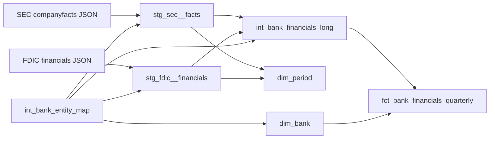

# Warehouse lineage

Committed picture of the quarterly bank-financials DAG. `dbt docs generate`
writes the interactive graph under `dbt/target/`. This file is the reviewable
copy.

`dev` reads `data/raw`. `ci` reads `tests/fixtures/metrics`. The DuckDB file
for `dev` is `data/warehouse/capitalcite.duckdb`. The DuckDB file for `ci` is
`dbt/target/ci.duckdb`.
